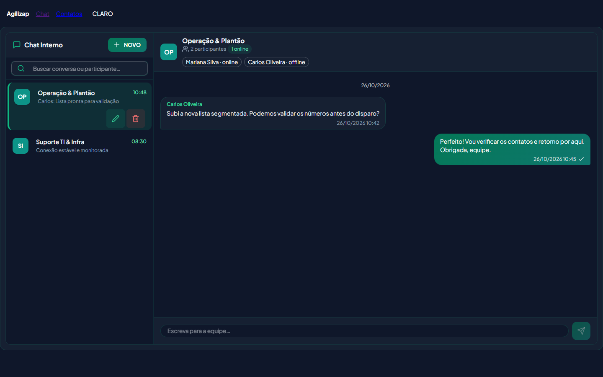
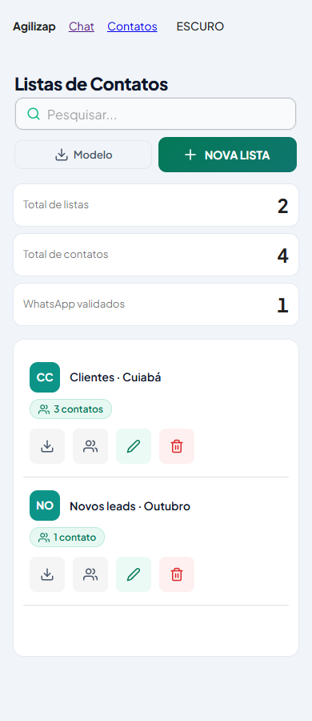
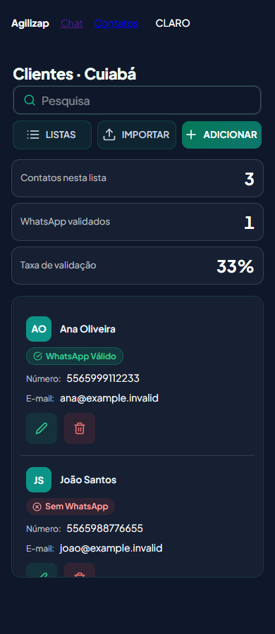

# Fase 5 — Chat interno e listas de contatos

Data: 26/10/2026. Branch: `feat/modernizacao-fase-5-ui-chat-e-contatos`.

Base confirmada: `main` atualizada para `51e9eed`, merge da PR #8 (Fase 4), antes da criação da branch.

## Entrega

- Migração dos cinco arquivos previstos para TSX, com contratos centrais de conversas, mensagens, participantes, listas e contatos em `src/types`.
- Paleta Emerald & Teal, superfícies Slate no tema escuro, fonte existente Plus Jakarta Sans e ícones Feather da dependência já instalada `react-icons`.
- Cabeçalho com participantes e presença informada pelo backend; busca por conversa ou participante; estados de carregamento, erro com nova tentativa e vazio; navegação de conversa em uma coluna em telas menores.
- Compositor com Enter para enviar, Shift + Enter para nova linha, proteção durante composição de texto e manutenção do rascunho quando o envio falha. Respostas HTTP antigas não contaminam outra conversa; eventos duplicados não repetem mensagens.
- Carregamento explícito de conversas e mensagens anteriores, links diretos para conversas fora da primeira página e preservação da posição ao carregar histórico.
- KPIs consultados no servidor para toda a empresa ou para a lista selecionada, independentes da busca e paginação da tabela. Não há transferência de todos os contatos para calcular indicadores.
- Badges distintos para WhatsApp válido, sem WhatsApp e não validado. Ações com nomes acessíveis, tooltips e alvos de toque de 44px. Em celulares, as linhas exibem todos os campos e ações em blocos verticais.
- Download do modelo preservado; a exportação por linha agora baixa os contatos daquela lista em XLSX, com as colunas de importação `nome`, `numero` e `email`.

## Alterações de suporte no backend

As rotas `GET /contact-lists/stats` e `GET /contact-lists/:id/stats` passam pelo `isAuth` e pela autorização existente: acesso administrativo e conferência de empresa da lista. Todas as contagens filtram pelo `companyId` da sessão.

As respostas de chat incluem apenas `id`, `name` e `online` para seus participantes. A contagem de conversas usa `distinct`; a paginação de listas interpreta corretamente o resultado agrupado do Sequelize. Nenhuma migração ou mudança nas sessões Baileys foi necessária.

## Validação automatizada

| Verificação | Resultado |
| --- | --- |
| Backend `npm run build` (`tsc`) | Aprovado |
| Frontend `npm run typecheck` | Aprovado |
| Frontend `npm run build` | Aprovado |
| `test:security` | 23/23 |
| `test:governance` | 12/12 |
| `test:reliability` | 14/14 |
| `test:ai-supervision` | 14/14 |
| `test:operation` | 15/15 |
| `test:homologation` | 14/14 |
| Total backend | **92/92** |

Os quatro novos cenários de homologação exercitam contagens além da primeira página, isolamento de empresas/listas, autorização dos indicadores, paginação agrupada e presença dos participantes com contagem distinta de conversas. Os testes usam PostgreSQL/WASM isolado, sem serviços de produção.

O build normal mantém o aviso existente de depreciação da API CommonJS do Vite; não apresenta erros de compilação.

## Revisão da interface

Prévia de produção isolada, renderizando os componentes reais com APIs e sockets simulados e uma navegação simplificada de homologação. Dados fictícios usados somente na validação: Mariana, Carlos, Ana, João e Paula; duas conversas e duas listas. Esses dados não entram no aplicativo.

Dez verificações de interação aprovadas: cabeçalho/presença, busca e vazio, seleção repetida, envio multilinha, rascunho após falha, troca rápida de conversa, desduplicação de socket, fechamento após evento de remoção do participante, KPIs estáveis durante busca e três estados de validação dos contatos.

Capturas em 1440, 768 e 390px, nos temas claro e escuro: 18 combinações sem overflow horizontal da página e sem exceções JavaScript. Direção de apoio: Framed sheet, seed `1251592685`; identidade, cores, fonte, gradientes e superfícies seguem a especificação e o protótipo do projeto. Gradientes foram permitidos no inspetor por essa exigência explícita. O espaço livre no histórico curto é intencional para manter o compositor no rodapé.

### Limites da validação

A presença visual corresponde ao campo `online` recebido do servidor no carregamento ou evento da conversa; esta fase não altera a infraestrutura de presença. O indicador de envio confirma que a mensagem foi salva, sem prometer leitura por cada participante. O filtro de conversas pesquisa as páginas já carregadas; o botão de carregar mais permanece disponível durante a busca.

A revisão visual usa fixtures para evitar conexões externas. Importação com validação real de números pelo WhatsApp e presença em uma sessão de produção não foram exercitadas no navegador. As seis suítes verificam as regressões de segurança, concorrência, isolamento e estabilidade sem conectar uma conta real.
